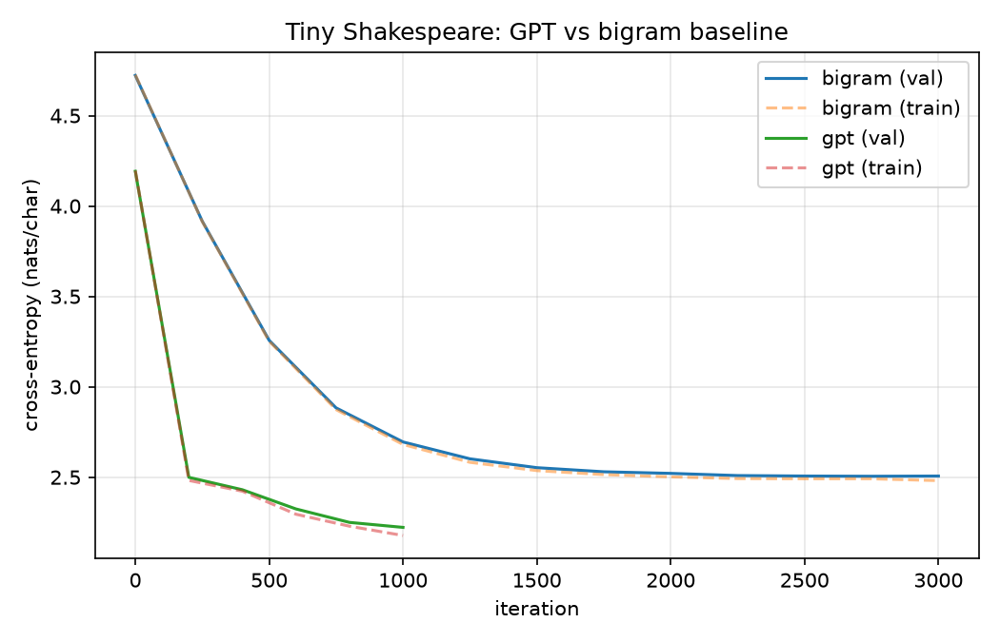

# mini-gpt: a Transformer language model from scratch in PyTorch

A decoder-only transformer (GPT-2 style) implemented from scratch, trained on character-level
Tiny Shakespeare and benchmarked against a bigram baseline. No `transformers` library, only `torch`.

Reproduces the architecture from [*Attention Is All You Need*](https://arxiv.org/abs/1706.03762)
(decoder stack with causal self-attention) with the GPT-2 refinements:
pre-LayerNorm, GELU MLP, tied embeddings, scaled residual init.

## What's implemented
- Multi-head causal self-attention, both an explicit `softmax(QK^T/sqrt(d))V` version and the fused
  `scaled_dot_product_attention` kernel, with a test that they match
- Learned positional embeddings, residual blocks, weight tying
- AdamW with decoupled weight decay (no decay on biases/norms), warmup + cosine LR, gradient clipping
- Temperature / top-k sampling
- Bigram baseline for a meaningful comparison
- Unit tests: output shapes, **causality** (future tokens can't leak), attention equivalence, overfit-one-batch

## Quickstart
```bash
pip install -r requirements.txt
pytest -q                                   # sanity tests

python train.py --model bigram --max_iters 3000
python train.py --model gpt                 # small config, runs on CPU
python compare.py                           # writes results.png + prints table
python generate.py --ckpt checkpoints/gpt.pt --tokens 500
```
Larger GPU config (~10.7M params):
```bash
python train.py --model gpt --n_layer 6 --n_head 6 --n_embd 384 --block_size 256 \
                --batch_size 64 --max_iters 5000 --lr 1e-3 --dropout 0.2
```

## Results

Measured on CPU with Tiny Shakespeare, seed 1337, and the settings shown below. The GPT run uses a
smaller configuration and fewer evaluation batches than the bigram run to keep CPU training practical;
the results are illustrative, not a controlled comparison of model size or training budget.

| Model | Params | Val loss | Val perplexity | Train time (s) |
|---|---|---|---|---|
| bigram | 4,225 | 2.5063 | 12.26 | 12 |
| gpt | 111,296 | 2.2223 | 9.23 | 98 |



## Notes / what I learned
- With the measured settings, GPT reduced validation loss by about 11% relative to the bigram baseline
  (2.2223 vs. 2.5063) and validation perplexity from 12.26 to 9.23, at the cost of more training time.
- The GPT benchmark used 2 layers, 2 heads, 64 embedding dimensions, batch size 16, 1,000 iterations,
  and 10 batches per evaluation. The bigram baseline used the default batch size and 3,000 iterations.
- Both runs used block size 128, dropout 0.1, and seed 1337. Training times are specific to this CPU
  environment; use the larger configuration in Quickstart for a stronger GPT model, preferably on GPU.

## Ideas to extend
- Ablations: remove positional embeddings, vary heads/layers, swap in RoPE
- Replace LayerNorm with RMSNorm; add KV-cache for faster generation
- Subword tokenizer (BPE) instead of characters
